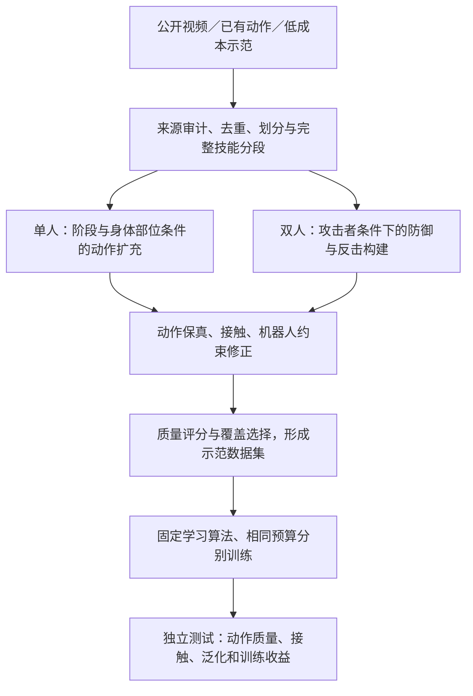

# 跟踪器升级、失败原因与当前算法流程

2026-09-16。研究主线保持 Demonstration Data Construction（示范数据构建）；本轮实际接入两个已有跟踪系统，作为数据质量诊断器，不把控制器换代写成本文创新。

## 1. 本轮已经执行

新增24次完整物理仿真：TWIST2的2个公开权重×2个控制频率×4条拳脚动作，共16次；SONIC同4条动作，共4次；两个系统各主/独立站立见证，共4次。全部结束。所有正式动作使用上一轮相同完整参考，未截短、放慢、缩幅或按结果删样本；旧实验仍保留。

TWIST2执行固定官方源代码中的观测、历史缓冲、ONNX推理及PD运算片段，绕过Redis和显示。SONIC采用公开权重与HumanTracker的观测/动作适配代码及其机器人模型，**不是官方C++部署或HumanTracker全套复现**。两者通过独立文档复跑及有限数值检查。CPU ONNX推理、CPU MuJoCo仿真；CUDA计算仅作为环境见证，新增策略训练步数0。

## 2. 为什么此前没有通过

**首先是水平运动与身体轨迹不匹配，而不是主要因为身体高度不对。** 旧TWIST在4条完整格斗参考上，平均根位置误差0.38887 m，水平误差0.38750 m，高度误差仅0.01652 m；平均朝向误差0.7843 rad。四条都没有跌倒，却没有一条每帧同时满足全局位置、身体位置和关节阈值。

另一项独立问题是技能变形：旧TWIST回旋踢/侧踢的局部运动幅度分别约为参考的54.4%/75.3%。上一轮算法只改根高度，不改关节、根朝向或水平路径，无法直接修复这两类误差。贴地组还使回旋踢跌倒。这是实测限制，不是“调几次高度一定能好”的问题。

**接口能力也需要匹配评价目标。** TWIST/TWIST2部署接口不直接接收“目标绝对水平位置减当前水平位置”的误差。SONIC此次G1模式输入未来关节位置、关节速度和相对根朝向，但不直接输入参考世界XY轨迹。因此它们能够改善姿态和动作，却未必纠正累计水平漂移。此判断来自读取输入字段；它解释能力边界，但不是对全部失败的唯一因果证明。不能仅因这些控制器失败，就把动作宣布为物理不可执行。

数据/模型因素尚未全部排除：PBHC源为23关节，旧TWIST25关节、新系统29关节；新增腕关节填中性值，模型质量分布、碰撞几何和执行器不同。简单站立通过验证接口能运行，不证明高速腿部动作的所有映射都正确。

此前BeyondMimic诊断已经使用成熟算法，512环境×24步×1000更新的预算与公开默认4096环境×24步×30000上限不同。它是短预算诊断；既不能当作充分收敛的原论文基线，也不能认定失败唯一来自训练不够。

## 3. 文献与实现选择

| 方法 | 核实的来源 | 本轮使用方式 | 适用范围与限制 |
|---|---|---|---|
| TWIST2 | [官方仓库](https://github.com/amazon-far/TWIST2)，论文题名 *TWIST2: Scalable, Portable, and Holistic Humanoid Data Collection System* | 固定提交 `d5c7108e9ef82d1b8770e5b692f27a1294f3aa8a`，公开20k/25k ONNX | 完整29关节公开控制器；不是双人接触控制器，不能假定高动态动作均成功 |
| SONIC | [作者项目](https://nvlabs.github.io/GEAR-SONIC/)，Science Robotics 2026，DOI `10.1126/scirobotics.aed4592`；[公开模型](https://huggingface.co/nvidia/GEAR-SONIC) | 默认公开权重，修订 `6733128a3d8a523b1418b06bca3cdf61c8b0987f` | 未来运动编码和通用解码控制；训练使用大量MoCap，不能因当前推理无需新MoCap就声称完全不依赖MoCap |
| HumanTracker | [作者仓库](https://github.com/GalaxyGeneralRobotics/HumanTracker)，本轮仅作工程来源 | 固定提交 `79d637da5e07b8e2c588ca613d3254f9d8acc0f7` 的SONIC观测/动作构建代码 | 未运行其完整测试集、HumanScore或论文表格，不用适配结果冒称官方benchmark成绩 |
| BeyondMimic | [官方训练工程](https://github.com/HybridRobotics/whole_body_tracking) | 保留现有实现作为后续需位置反馈的备选 | 基础观测配置包含 motion_anchor_pos_b（参考锚点相对位置），但不同任务版本可能删除该项；必须核对实际checkpoint输入，不能随意给旧权重新增维度 |

KungfuBot仍提供数据预处理与动作专用执行校准；已公开的马步/冲拳权重不能充当所有动作的通用策略。没有重训SONIC；其大规模训练配方也不能承诺在2×A6000上直接复现。

## 4. 控制频率核查

TWIST2官方 `sim2sim.sh`指定20k权重、100Hz；其G1训练配置继承 `dt=0.002` 与 `decimation=10`，对应50Hz。HumanTracker示例选择25k/50Hz。

最初先分别执行官方部署选择和benchmark选择，随后增加20k/50Hz、25k/100Hz交叉对照，避免将频率差异误归因于权重差异。交叉对照是观察结果后的开发诊断，所有结果均保留，不是预注册确认性实验。100Hz使用同一50Hz参考帧两次，改变历史缓冲的时间跨度，属于部署时序差异。

同一20k权重从100Hz改为50Hz，未跌倒数从1/4变为4/4，但严格通过仍0/4；因此频率是本开发集的重要影响因素，却不是完整解决方案。不能把这个结果扩展成“100Hz总比50Hz差”。

## 5. 不变的严格标准与结果

每帧关节MAE<0.3 rad、根位置误差<0.15 m、所选身体平均位置误差<0.15 m、骨盆高度≥0.35 m。保持旧评分；另外计算23个共同非腕关节，避免新增腕关节稀释误差。两种关节口径得到相同的完整通过数。

| 系统配置 | 未跌倒 | 严格通过 | 共同23关节MAE(rad) | 根位置误差(m) | 朝向误差(rad) |
|---|---:|---:|---:|---:|---:|
| 原TWIST25 | 4/4 | 0/4 | 0.13480 | 0.38887 | 0.78427 |
| TWIST2 20k/100Hz | 1/4 | 0/4 | 0.18776 | 0.55669 | 0.61753 |
| TWIST2 25k/50Hz | 3/4 | 0/4 | 0.13756 | 0.41777 | 0.46293 |
| TWIST2 20k/50Hz | 4/4 | 0/4 | 0.11472 | 0.26270 | 0.48407 |
| TWIST2 25k/100Hz | 1/4 | 0/4 | 0.17532 | 0.60181 | 0.78544 |
| SONIC/HumanTracker适配 | 4/4 | **1/4** | 0.13136 | 0.36809 | **0.06412** |

不同系统采用各自原生模型、控制增益及初始化方式，且旧TWIST使用MuJoCo3.3.7、新推理环境3.2.3；这是一组部署系统诊断，不是排除所有混杂因素的算法排名。均值包含失败后帧，逐条JSON保留首跌和首失配时间。相同输入文件哈希已检查，控制器预训练数据重叠未知。

SONIC逐技能结果：

| 动作 | 严格通过 | 根误差(m) | 拳脚局部误差(m) | 实际/参考幅度 | 实际/参考速度 |
|---|---|---:|---:|---:|---:|
| 马步冲拳 | **是，完整6.62s** | 0.07639 | 0.02359 | 1.088 | 0.933 |
| 勾拳 | 否 | 0.17140 | 0.02017 | 1.117 | 0.833 |
| 侧踢 | 否 | 0.38085 | 0.09014 | 1.078 | 0.753 |
| 回旋踢 | 否 | 0.84372 | 0.21136 | 0.948 | 1.008 |

这些局部幅度/速度是骨盆旋转坐标系中的开发诊断，定义沿用上一轮，不等于攻击命中或完整轨迹正确。回旋踢幅度恢复很多，但水平路径更差；侧踢幅度恢复，速度仍不足。**因此SONIC更适合下一轮姿态/技能保真诊断，却尚不能作为已完全合格的全局格斗参考验收器。**

## 6. 当前算法流程：已实现和待完成分开

| 环节 | 当前真实实现状态 | 方法依据/角色 |
|---|---|---|
| 来源与表示 | 已有KungFuAthlete视频动作、InterHuman/ReMoCap相关接口；本轮新增PBHC完整动作审计。最终独立格斗标签及传感器MoCap主对照仍不完整 | 数据来源不能混为MoCap；父样本及后代须同划分 |
| 单人候选扩充 | 存在早期小型关节扩散pilot；新“阶段/部位条件”的完整方案尚未实现并验证 | MotionDreamer用于局部条件扩充思路，不能称已完整复现 |
| 双人候选构建 | 已接入TIMotion及条件适配、攻击者条件/反应模块；已有组件和基准诊断 | InterMask/InterGen等为表示与交互生成借鉴，不表示当前代码已实现所有模型 |
| 数据修正 | 已有双人几何接触/时序组件；单人仅验证了根高度有界/阶段保护修正，结果尚无稳定收益 | KungfuBot、PhysDiff等提供修正思想；完整接触力与动力学联合约束尚未实现 |
| 质量与覆盖选择 | 有运动学检查、来源检查和已有覆盖评分诊断；缺可靠跨来源物理正负标签 | 不能把单个跟踪器失败当作“不可执行”真值，不能只筛简单站立样例 |
| 固定执行诊断 | 已有TWIST、PBHC动作专用策略，本轮新增TWIST2和SONIC适配 | 完整物理状态和不变严格评分；不是新增控制算法贡献 |
| 下游学习收益 | 历史短预算训练结果保留；新单人4组×3种子训练尚未开始 | 比较真实/视频种子、普通扩充、本方法；同算法同预算，独立测试 |

目前真正端到端跑通的是“完整参考→有限数据修正→固定策略物理执行→质量诊断”的开发闭环。并不是整套新生成算法已经实现，只剩调跟踪器。

## 7. 下一步决策

1. 保留SONIC作为第二个固定姿态/技能验证器，保留TWIST2 20k/50Hz作为部署诊断对照，不把开发结果用于最终测试集上的模型挑选。全部4条完整动作继续保留。
2. 数据侧进一步检查支撑脚世界轨迹、根平移/朝向与关节FK（正向运动学）的相容性。下一修正模块应联合考虑这些量，而不是继续只移动根高度。
3. 若任务要求严格攻防相对位置，则验证器必须有与位置目标匹配的反馈接口。优先核验现有BeyondMimic的带锚点位置任务与完整动作参考，再做有收敛检查的基线训练；不能给不接受XY目标的权重硬拼输入，也不能将控制器实际根轨迹写回参考后自评“成功”。
4. 先证明数据修正在未改动、与任务匹配的验证器上有用，再实现阶段/部位扩充和质量选择；最终学习效用实验按固定数据组、固定初始化/预算和独立来源测试执行。本轮不声称已达到全部S1–S4门槛。

## 8. 产物

服务器：`runs/twist2_upgrade_20260916/`、`runs/sonic_probe_20260916/`；汇总 `records/tracker_upgrade_20260916/summary.json` 与 `summary.csv`。

独立复现说明：`docs/twist2_inference_20260916.md`、`docs/sonic_probe_20260916.md`。结果包包含实际状态，不公开再分发第三方模型权重。SONIC权重适用NVIDIA Open Model License，HumanTracker源代码Apache2.0，TWIST2源代码MIT；PBHC派生输入沿用其非商业许可来源记录。
